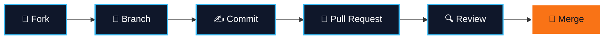

 

 

## 👋 Who we are

**The Bachelors** is a student-led community that brings undergraduates from different universities together to learn software development the way it's actually done: by building real things, reviewing each other's code, and shipping.

We believe the best way to grow as a developer is alongside other people. So we've built a space where beginners and experienced students work in the same repositories, learn from each other, and contribute to something bigger than a class assignment.

## 🎯 What we stand for

<table>
<tr>
<td width="25%" valign="top" align="center">

### 🌍 Cross-university
Students from any campus are welcome. Different backgrounds make better ideas.

</td>
<td width="25%" valign="top" align="center">

### 🤝 Collaboration
Branches, pull requests and code reviews are part of everyday learning.

</td>
<td width="25%" valign="top" align="center">

### 🔓 Open source
Everything we build is public, shareable and open to improvement.

</td>
<td width="25%" valign="top" align="center">

### 💬 Supportive
No gatekeeping, no judgment. Ask freely, answer kindly, grow together.

</td>
</tr>
</table>

## 🚀 Start here

Our home base is the **Community** repository. It holds our learning material, shared projects and contributions from every member.

## ⚡ How we work

Every change goes through review, so nothing reaches `main` unchecked. It's the same workflow used by professional engineering teams, practised in a friendly environment.

## 🧭 Find your place

| If you are... | You can... |
|:--|:--|
| 🌱 **New to coding** | Learn Git and GitHub, make your first contribution, ask anything |
| 🔨 **Already building** | Work on shared projects, pitch your own, collaborate across campuses |
| 🔍 **Detail-oriented** | Review pull requests and help keep the code clean |
| 🧙 **Experienced** | Mentor newer members and share what you've learned |

## 🧰 Tech we use

## 🤗 Our culture

We keep it simple:

- **Be kind.** Critique the code, never the person.
- **Be curious.** Every question is a good question.
- **Be honest.** Credit others' work and own your mistakes.
- **Be inclusive.** Everyone here is a learner first.

Harassment, discrimination or disrespect of any kind is not tolerated.

## 📬 Get involved

- 🍴 **Contribute:** fork the [Community repo](https://github.com/The-Bachelors/Community) and open a pull request
- 💡 **Suggest:** [open an issue](https://github.com/The-Bachelors/Community/issues) with an idea or improvement
- ⭐ **Support:** star our repositories and share us with friends at your university

 

 

