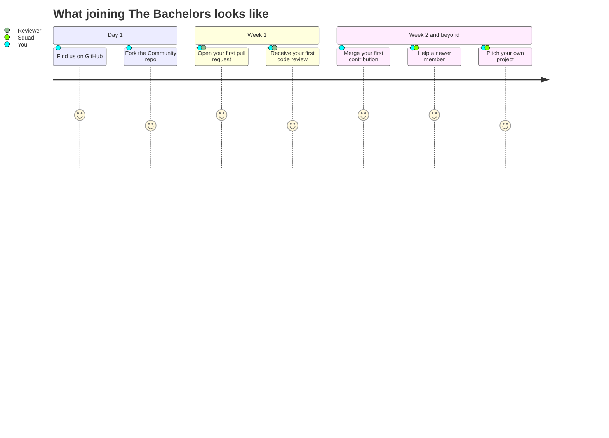
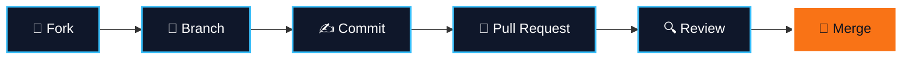

<div align="center">


<a href="https://github.com/The-Bachelors/Community">
  
</a>

<br/>

<a href="https://github.com/The-Bachelors/Community"></a>
<a href="https://github.com/The-Bachelors/Community/issues"></a>
<a href="https://github.com/The-Bachelors/Community/pulls"></a>

<br/><br/>


</div>

<br/>

<div align="center">

### *The best way to learn to code is to build with people who are learning too.*

</div>

<br/>


**The Bachelors** is a student-led community that brings undergraduates from different universities together to learn software development the way it's really done: by building things, reviewing each other's code, and shipping.

We built a space where a first-year who just discovered `git` and a senior with three projects under their belt work in the same repositories, learn from each other, and contribute to something bigger than a class assignment.

```text
┌─ bachelors@community ~
│
│  $ whoami
│  > a student who wants to build real things
│
│  $ cat requirements.txt
│  > curiosity, teamwork, a laptop
│  > everything else? we learn it together
│
│  $ ./join --university=any --level=any
│  > welcome aboard.
│
└─ connection established
```

<br/>


<table>
<tr>
<td width="25%" valign="top" align="center">

### 🌍<br/>Cross-university
<sub>Any campus, any degree. Different backgrounds make for better ideas.</sub>

</td>
<td width="25%" valign="top" align="center">

### 🤝<br/>Collaboration
<sub>Branches, pull requests and reviews are part of everyday learning.</sub>

</td>
<td width="25%" valign="top" align="center">

### 🔓<br/>Open source
<sub>Everything we build is public, shareable and open to improvement.</sub>

</td>
<td width="25%" valign="top" align="center">

### 💬<br/>Supportive
<sub>No gatekeeping, no judgment. Ask freely, answer kindly, grow together.</sub>

</td>
</tr>
</table>

<br/>


Our home base is the **Community** repository: learning material, shared projects, and contributions from every member.

<div align="center">

<a href="https://github.com/The-Bachelors/Community">
  
</a>

</div>

<br/>




<br/>




Every change gets reviewed before it reaches `main`. It's the same workflow professional engineering teams use, practised in a friendly place to make mistakes.

<br/>


<div align="center">

| | |
|:--|:--|
| 🧱 **Git fluency** | Branching, merging and conflict resolution without the panic |
| 🔍 **Code review skills** | How to give feedback that helps and receive it without ego |
| 📁 **A real portfolio** | Public contributions you can show to recruiters and professors |
| 🌐 **A cross-campus network** | Friends and collaborators at universities beyond your own |
| 🚀 **Shipping confidence** | The habit of finishing things and putting them out there |

</div>

<br/>


<div align="center">

| If you are... | You can... |
|:--|:--|
| 🌱 **New to coding** | Learn Git and GitHub, make your first contribution, ask anything |
| 🔨 **Already building** | Work on shared projects, pitch your own, collaborate across campuses |
| 🔍 **Detail-oriented** | Review pull requests and help keep the code clean |
| 🧙 **Experienced** | Mentor newer members and share what you've learned |

</div>

<br/>


<div align="center">


<sub>and whatever new tool someone convinces us to try next</sub>

</div>

<br/>


<table>
<tr>
<td width="50%" valign="top">

**🟢 Be kind.** Critique the code, never the person.<br/><br/>
**🔵 Be curious.** Every question is a good question.

</td>
<td width="50%" valign="top">

**🟠 Be honest.** Credit others' work and own your mistakes.<br/><br/>
**🟣 Be inclusive.** Everyone here is a learner first.

</td>
</tr>
</table>

<sub>Harassment, discrimination or disrespect of any kind is not tolerated.</sub>

<br/>


- 🍴 **Contribute:** fork the [Community repo](https://github.com/The-Bachelors/Community) and open a pull request
- 💡 **Suggest:** [open an issue](https://github.com/The-Bachelors/Community/issues) with an idea or improvement
- ⭐ **Support:** star our repositories and tell a friend at your university

<br/>

<div align="center">

<a href="https://github.com/The-Bachelors/Community">
  
</a>

<br/>


</div>
